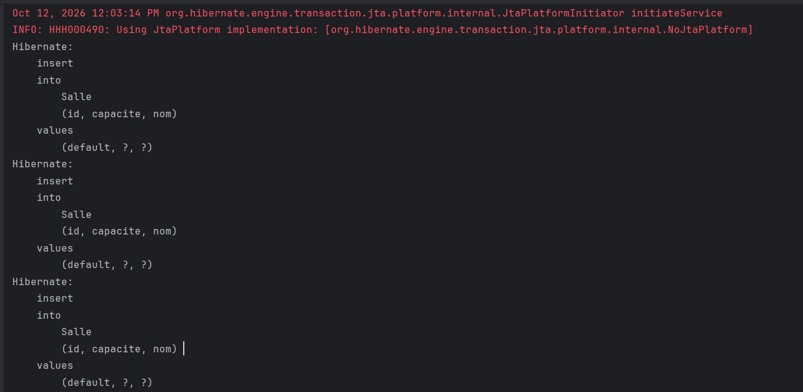
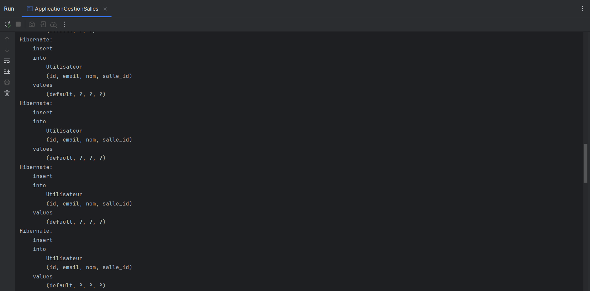
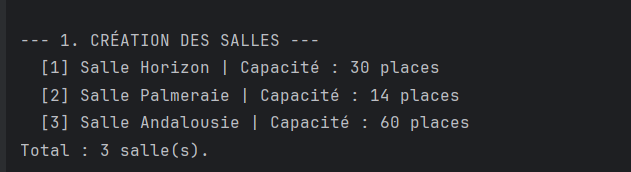
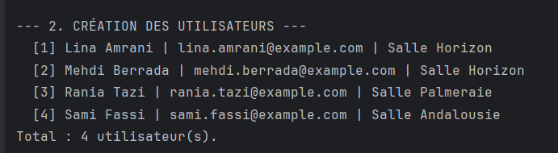
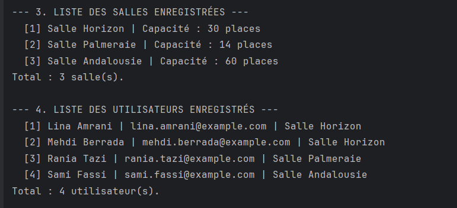
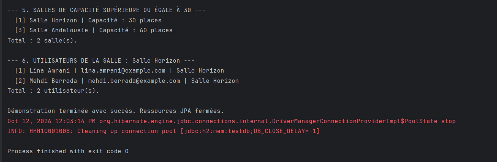

# Gestion des salles avec JPA et Hibernate

J'ai réalisé ce projet pour pratiquer la persistance des données avec Java, JPA et Hibernate. L'application fonctionne en console : elle permet de gérer des salles, d'y affecter des utilisateurs et d'effectuer quelques recherches.

## Ce qu'on peut faire

- Créer des salles avec un nom et une capacité.
- Ajouter des utilisateurs et les affecter à une salle.
- Consulter les salles et les utilisateurs enregistrés.
- Rechercher les salles selon leur capacité et les utilisateurs d'une salle.

## Technologies

Java 21 · Maven · JPA 2.2 · Hibernate 5.6 · H2 (en mémoire) · JUnit 4

## Organisation du code

J'ai séparé le projet en quelques parties pour que chaque classe ait un rôle clair :

- `entities` : les classes `Salle` et `Utilisateur`, liées par une relation plusieurs-vers-un.
- `dao` : la persistance, les opérations CRUD et les requêtes JPQL.
- `service` : les opérations utilisées par l'application.
- `ApplicationGestionSalles` : la démonstration en console.

La configuration de la base H2 se trouve dans `src/main/resources/META-INF/persistence.xml`. Aucune base externe n'est nécessaire.

## Lancer le projet

Il faut avoir **Java 21** et **Maven** installés.

```bash
git clone https://github.com/SaraHarib/gestion-salles-jpa-hibernate.git
cd gestion-salles-jpa-hibernate
mvn -B -ntp compile
```

Pour voir la démonstration, ouvrir le projet dans un IDE Java (par exemple IntelliJ IDEA) et exécuter `ApplicationGestionSalles.main()`.

## Tests

Les **4 tests JUnit métier** sont dans `src/test/java/com/example/jpa/ServiceGestionTest.java`. Ils vérifient :

- la création et la lecture d'une salle ;
- la création d'un utilisateur et son association à une salle ;
- la recherche des utilisateurs d'une salle, y compris sans résultat ;
- la recherche par capacité minimale, y compris sur la valeur limite.

Pour lancer les tests et la vérification Maven :

```bash
mvn -B -ntp verify
```

Il reste aussi un test `AppTest.java` provenant du squelette Maven ; il ne teste pas de fonctionnalité métier.

Un workflow GitHub Actions exécute cette commande automatiquement sur les pull requests vers `main`. Le résultat est visible dans l'onglet [Actions](https://github.com/SaraHarib/gestion-salles-jpa-hibernate/actions).

## Quelques captures

**Ajout des données avec Hibernate**




**Création et consultation**





**Recherches JPQL**



---

Ce projet m'a surtout aidée à mieux comprendre les relations JPA, les transactions, les DAO et les requêtes JPQL. C'est un exercice Java en console, pas une application web.
