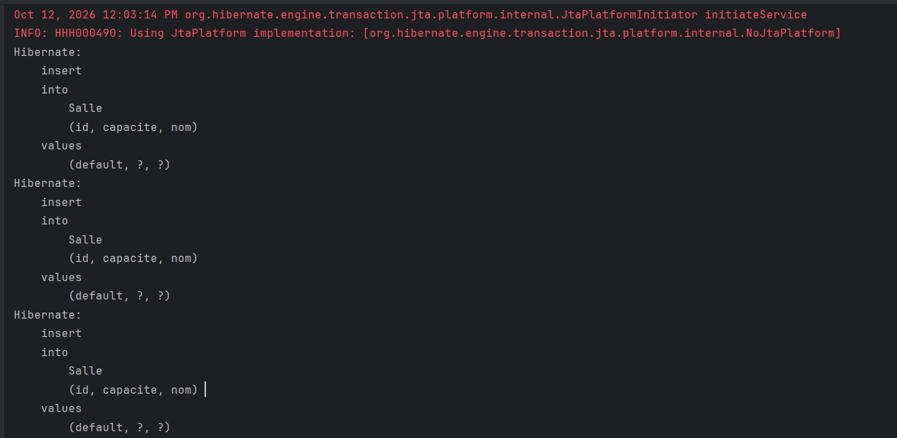
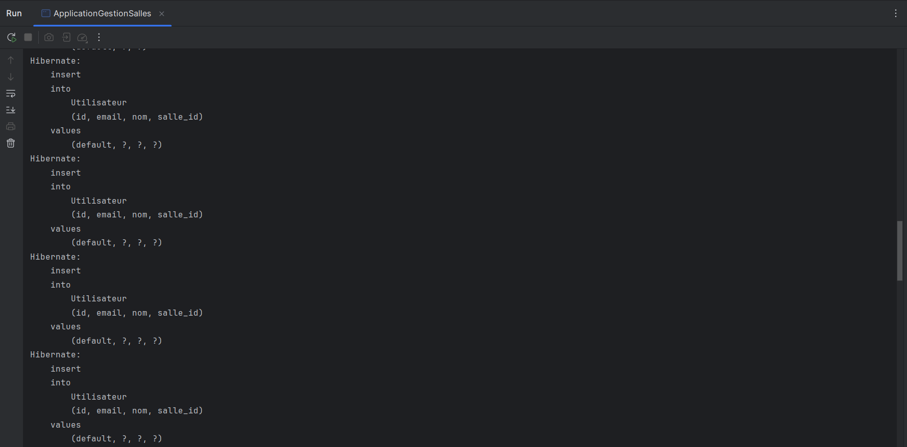
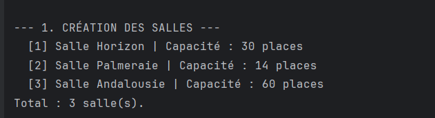
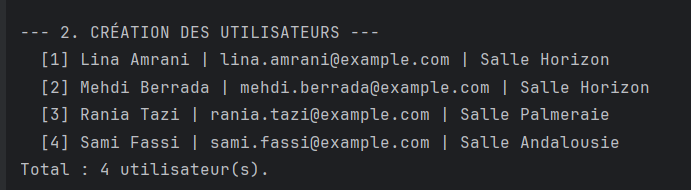
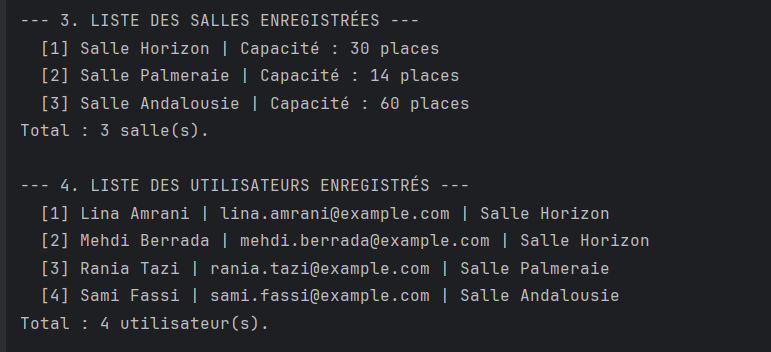
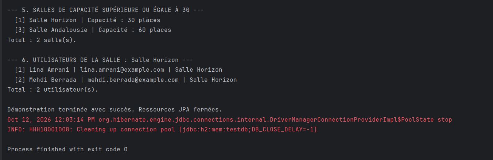

# TP - Gestion des salles avec JPA et Hibernate

## 1. Présentation

Ce TP consiste à gérer des salles et des utilisateurs avec JPA et Hibernate. L'application fonctionne sans EJB et utilise une base H2 en mémoire. Elle permet d'enregistrer des données, d'associer des utilisateurs à une salle et de faire des recherches depuis une démonstration en console.

## 2. Objectifs du TP

- Configurer le projet Maven et ses dépendances.
- Configurer JPA et Hibernate avec l'unité de persistance gestionPU.
- Définir les entités Salle et Utilisateur.
- Mettre en place une relation ManyToOne : plusieurs utilisateurs peuvent être associés à une même salle.
- Créer un DAO générique pour les opérations communes et des DAO spécifiques pour les recherches.
- Regrouper les opérations métier dans un service.
- Gérer manuellement les transactions.
- Utiliser des requêtes JPQL paramétrées.
- Vérifier le fonctionnement avec des tests JUnit.
- Présenter les résultats dans une démonstration d'exécution.

## 3. Technologies utilisées

- Java 21
- Maven
- JPA 2.2 avec javax.persistence
- Hibernate 5.6.15.Final
- H2 2.1.214, en mémoire
- JUnit 4.13.2
- IntelliJ IDEA

## 4. Organisation du projet

Le projet suit la structure Maven classique. Les classes de l'application se trouvent dans src/main/java et la configuration JPA dans src/main/resources/META-INF.

- **entities** : contient Salle et Utilisateur, leurs attributs et la relation entre les deux entités.
- **dao** : contient GenericDao pour la création, la lecture, la modification, la suppression et la récupération de toutes les entités. SalleDao et UtilisateurDao ajoutent les recherches spécifiques.
- **service** : contient ServiceGestion, qui initialise les ressources JPA, utilise les DAO et expose les opérations métier. Il assure aussi la fermeture des ressources.
- **Tests** : placés dans src/test/java, dans le package com.example.jpa. ServiceGestionTest vérifie les opérations du service et les recherches sur la base H2.

La classe ApplicationGestionSalles, dans le package com.example.jpa, lance la démonstration et affiche les résultats dans la console.

## 5. Fonctionnalités réalisées

- Création de salles avec un nom unique et une capacité.
- Création d'utilisateurs avec un nom et un email unique.
- Association d'un utilisateur à une salle.
- Récupération et affichage de toutes les salles et de tous les utilisateurs.
- Recherche de salles selon une capacité minimale.
- Recherche des utilisateurs affectés à une salle à partir de son nom.
- Gestion des transactions d'écriture dans les DAO : ouverture, validation par commit et rollback si une exception survient alors que la transaction est encore active.
- Utilisation de JPQL pour récupérer les listes et effectuer les recherches paramétrées.

## 6. Captures d'écran d'exécution

### 6.1 Insertion des salles avec Hibernate

Cette capture montre les requêtes SQL générées par Hibernate lors de l'enregistrement des salles dans H2. Chaque insertion correspond à une salle créée par l'application.

### 6.2 Insertion des utilisateurs avec Hibernate

Cette capture montre l'insertion des utilisateurs dans la base. La colonne salle_id contient l'identifiant de la salle associée à chaque utilisateur et représente la liaison entre les deux entités.

### 6.3 Création des salles

Trois salles de capacités différentes sont créées et enregistrées. La console affiche leur identifiant, leur nom et leur capacité :

- Salle Horizon : 30 places.
- Salle Palmeraie : 14 places.
- Salle Andalousie : 60 places.

### 6.4 Création des utilisateurs

Quatre utilisateurs sont créés et associés aux différentes salles. Lina Amrani et Mehdi Berrada sont affectés à Salle Horizon, Rania Tazi à Salle Palmeraie et Sami Fassi à Salle Andalousie. La console présente aussi leurs emails fictifs.

### 6.5 Vérification des données enregistrées

Cette partie permet de vérifier la récupération de toutes les salles et de tous les utilisateurs depuis la base. On retrouve les trois salles et les quatre utilisateurs enregistrés, avec leurs informations et leurs associations.

### 6.6 Recherches avec JPQL et fin de l'exécution

La première recherche récupère les salles ayant une capacité supérieure ou égale à 30 places : Salle Horizon et Salle Andalousie. La seconde recherche retrouve les utilisateurs affectés à Salle Horizon : Lina Amrani et Mehdi Berrada.

La fin de la console indique la fermeture des ressources JPA. La ligne « Process finished with exit code 0 » confirme que l'exécution s'est terminée correctement.

## 7. Tests

Les quatre tests JUnit de ServiceGestionTest vérifient :

- La création et la lecture d'une salle, ainsi que sa présence dans la liste des salles.
- La création d'un utilisateur et la conservation de son association avec une salle.
- La recherche des utilisateurs par nom de salle, y compris lorsqu'aucun résultat n'est trouvé.
- La recherche de salles selon une capacité minimale, en incluant une salle dont la capacité est exactement égale au seuil.

Ces tests vérifient le fonctionnement du service et des recherches spécifiques des DAO. Un contexte JPA distinct permet de relire les données enregistrées. La base est nettoyée avant et après chaque test, et le service est fermé après chaque exécution pour garder les tests indépendants.

## 8. Conclusion

Ce TP m'a permis de mieux comprendre le rôle de l'EntityManager dans la persistance des entités et la gestion des relations JPA. J'ai appris à organiser l'accès aux données avec les DAO, à valider ou annuler une transaction et à écrire des recherches avec JPQL. La séparation entre les DAO et le service m'aide aussi à distinguer l'accès aux données de la logique métier.
